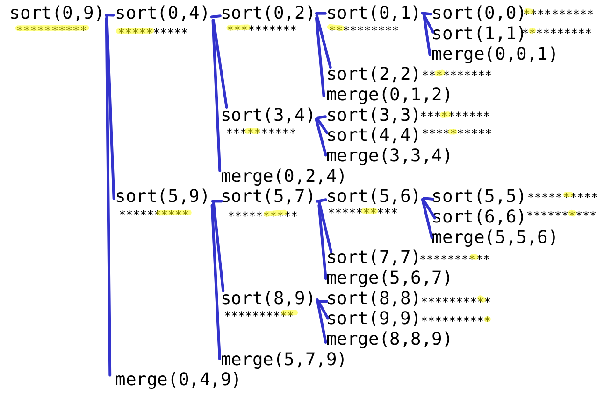

* TOC
{:toc}

## Oznamy

- **Druhý miniprojekt** je zverejnený, odovzdávajte do štvrtka 19.11. 22:00.
- **Druhý semestrálny test** bude v pondelok **7.12.** počas cvičení
- **Plán na dnes:** najskôr si ukážeme dva rýchle rekurzívne algoritmy na triedenie, potom sa vrátime k minulej téme prehľadávania s návratom.

## Rýchle triedenia prostredníctvom paradigmy „rozdeľuj a panuj”

Zatiaľ sme prebrali tri triediace algoritmy: *Bubble Sort*, *Insertion
Sort* a *Max Sort*. Všetky sú jednoduché, ale pomalé: majú kvadratickú
zložitosť *O(n<sup>2</sup>)*.

Dnes pridáme ďalšie dve triedenia, ktoré budú pre veľké polia omnoho
rýchlejšie: *Merge Sort* a *Quick Sort*. Obe sú založené na paradigme
*rozdeľuj a panuj* (angl. *divide and conquer*, lat. *divide et
impera*).

Rozdeľuj a panuj je paradigma rekurzívneho riešenia problémov pracujúca
v troch fázach:

  - **Rozdeľuj**: problém rozdelíme na menšie časti (t.j. podproblémy),
    ktoré sa dajú riešiť samostatne.
  - **Vyrieš podproblémy**: rekurzívne vyriešime úlohu pre každý
    podproblém.
  - **Panuj**: riešenia podproblémov spojíme do riešenia pôvodného
    problému.

## Triedenie zlučovaním (*Merge Sort*)

Triedenie zlučovaním (angl. *Merge Sort*) pracuje nasledovne:

  - Pole rozdelíme na dve približne rovnaké časti
  - Každú časť zvlášť rekurzívne utriedime
  - Vo fáze „panuj” sa tieto dve utriedené postupnosti zlúčia (angl.
    *merge*) do výsledného utriedeného poľa.

Príklad:

```
Vstupné pole rozdelené na polovicu:
|60 10 50 70 20|40 80 90 30 0|
Po rekurzívnom utriedení ľavej časti
|10 20 50 60 70|40 80 90 30 0|
Po rekurzívnom utriedení pravej časti
|10 20 50 60 70|0 30 40 80 90|
Po zlúčení
|0 10 20 30 40 50 60 70 80 90|
```

Triedenie zlučovaním tak bude vyzerať nasledovne (pričom zostáva
implementovať funkciu *merge*):

```c
void mergesort(int a[], int left, int right) {
    /* Triedenie zlučovaním od pozície left
     * po pozíciu right (vrátane) */

    // triviálny prípad: pole má najviac jeden prvok
    if (left >= right) {
        return;
    }

    // rozdeľuj: spočítame stred poľa 
    int middle = (left + right) / 2;

    // rekurzívne vyriešime podproblémy
    mergesort(a, left, middle);
    mergesort(a, middle + 1, right);

    // panuj: zlúčime obe usporiadané časti
    merge(a, left, middle, right);
}
```

### Zlúčenie dvoch utriedených podpostupností

Zostáva naprogramovať zlúčenie dvoch utriedených postupností
`a[left..middle]`, `a[middle+1..right]` do jednej utriedenej
postupnosti.

Príklad:

```
|10 20 50 60 70|0 30 40 80 90| -> |0 10 20 30 40 50 60 70 80 90|
```

Zlúčenú postupnosť budeme postupne ukladať do pomocného poľa `aux`,
pričom postupovať budeme nasledovne:

  - Prvým prvkom poľa `aux` bude menší z prvkov `a[left]` a
    `a[middle+1]`.
      - Ostanú nám postupnosti `a[left+1..middle]` a
        `a[middle+1..right]` alebo `a[left..middle]` a
        `a[middle+2..right]`.
  - Vo všeobecnosti máme postupnosti `a[i..middle]` a `a[j..right]`.
      - Ďalším prvkom poľa `aux` bude menší z prvkov `a[i]` a `a[j]`
      - Ostanú nám postupnosti `a[i+1..middle]` a `a[j..right]` alebo
        `a[i..middle]` a `a[j+1..right]`.
  - Toto robíme dovtedy, kým niektorú z postupností nevyčerpáme celú.
    Potom už len na koniec poľa `aux` dokopírujeme zvyšok druhej
    postupnosti.

Po spojení oboch postupností do utriedeného poľa `aux` toto pole
prekopírujeme naspäť do poľa `a`.

```c
void merge(int a[], int left, int middle, int right) {
    /* Zlúčenie dvoch usporiadaných častí poľa a.
     * Prvá časť je od indexu left po middle, druhá od middle + 1 po right */

    int aux[NMAX];      // pomocné pole
    int i = left;       // index v prvej časti
    int j = middle + 1; // index v druhej časti
    int k = 0;          // index v pomocnom poli

    while ((i <= middle) && (j <= right)) {
        // Kým sú a[i..middle] aj a[j..right] neprázdne,
        // menší z prvkov a[i], a[j] ulož do aux[k] a posuň indexy
        if (a[i] <= a[j]) {
            aux[k] = a[i];
            i++;
            k++;
        } else {
            aux[k] = a[j];
            j++;
            k++;
        }
    }

    // ak ešte zostali prvky v prvej časti, vložíme ich do aux
    while (i <= middle) {
        aux[k] = a[i];
        i++;
        k++;
    }

    // ak ešte zostali prvky v druhej časti, vložíme ich do aux
    while (j <= right) {
        aux[k] = a[j];
        j++;
        k++;
    }

    // nakoniec skopírujeme zlúčené prvky z aux späť do a
    // pozícia 0 v aux pôjde na pozíciu left v a
    for (int k = left; k <= right; k++) {
        a[k] = aux[k - left];
    }
}
```

### Ukážka na príklade

Uvažujme pole `a = {60, 10, 50, 70, 20, 40, 80, 90, 30, 0}`.

Volanie `mergesort(a,0,9)` potom utriedi pole `a` pomocou nasledujúcich
rekurzívnych volaní (`mergesort(a,l,r)` je na obrázku skrátené na
`sort(l,r)` a `merge(a,l,m,r)` na `merge(l,m,r)`, žltou sú vyznačené
pozície v poli, ktoré sa v danom volaní triedia):

{:width="500px"}

Pole `a` sa počas týchto volaní mení nasledovne:

```
merge(a,0,0,1): |60|10|50 70 20 40 80 90 30 0  -> |10 60|50 70 20 40 80 90 30 0
merge(a,0,1,2): |10 60|50|70 20 40 80 90 30 0  -> |10 50 60|70 20 40 80 90 30 0
merge(a,3,3,4):  10 50 60|70|20|40 80 90 30 0  ->  10 50 60|20 70|40 80 90 30 0
merge(a,0,2,4): |10 50 60|20 70|40 80 90 30 0  -> |10 20 50 60 70|40 80 90 30 0
merge(a,5,5,6):  10 20 50 60 70|40|80|90 30 0  ->  10 20 50 60 70|40 80|90 30 0
merge(a,5,6,7):  10 20 50 60 70|40 80|90|30 0  ->  10 20 50 60 70|40 80 90|30 0
merge(a,8,8,9):  10 20 50 60 70 40 80 90|30|0| ->  10 20 50 60 70 40 80 90|0 30|
merge(a,5,7,9):  10 20 50 60 70|40 80 90|0 30| ->  10 20 50 60 70|0 30 40 80 90|
merge(a,0,4,9): |10 20 50 60 70|0 30 40 80 90| -> |0 10 20 30 40 50 60 70 80 90|
```

### Odhad zložitosti

Zlučovanie dvoch postupností, ktoré spolu obsahujú *N* prvkov, trvá čas
*O(N)*. Prečo?

V algoritme máme *log<sub>2</sub> N* úrovní rekurzie:

  - na prvej spracovávame úseky dĺžky *N*,
  - na druhej *N/2*, na tretej *N/4* atď,
  - po *log<sub>2</sub> N* úrovniach dostaneme úseky dĺžky 1.

Na každej úrovni je každý prvok najviac v jednom zlučovaní, teda celkový
čas zlučovaní na každej úrovni je *O(N)*. Celkový čas výpočtu je *O(N
log N)*.

Celú implementáciu triedenia zlučovaním nájdete v ukážkovom programe [triedenia2.c](../programs/triedenia2.html)


## *Quick Sort*

*Quick Sort* je tiež založený na metóde rozdeľuj a panuj. Postupuje ale
nasledovne:

  - V rámci fázy *rozdeľuj* vyberie niektorý prvok poľa (napríklad jeho
    prvý prvok), ktorý nazve *pivotom*. Prvky poľa následne preusporiada
    na tri skupiny: v ľavej časti poľa budú prvky menšie ako pivot, za
    nimi pivot samotný a napokon v pravej časti prvky väčšie alebo rovné
    ako pivot.
  - *Rekurzívne utriedi* prvú a tretiu skupinu (druhá skupina má iba
    jeden prvok)
  - Vo fáze *panuj* už nemusí robiť nič. Po utriedení týchto
    skupín totiž vznikne utriedené pole.

Príklad:

```
Vstupné pole:
|60 10 50 70 20 40 80 90 30 0| 
Po rozdelení s pivotom 6:
|0 10 50 20 40 30|60|90 70 80|
Po rekurzívnom utriedení ľavej časti:
|0 10 20 30 40 50|60|90 70 80|
Po rekurzívnom utriedení pravej časti:
|0 10 20 30 40 50|60|70 80 90|
```

Základ triedenia tak bude vyzerať nasledovne (pričom zostáva
implementovať funkciu `partition`):

```c
void quicksort(int a[], int left, int right) {
    /* Triedenie QuickSort od pozície left
       po pozíciu right  (vrátane)*/

    // triviálny prípad: ak má pole najviac jeden prvok
    if (left >= right) {
        return;
    }

    // rozdelíme pole okolo pivotu 
    int middle = partition(a, left, right);
    // Po vykonaní funkcie: 
    // a[left..middle-1] sú menšie ako pivot 
    // a[middle] je pivot
    // a[middle+1..right] sú väčšie ako pivot

    // rekurzívne utrieď a[left..middle-1], a[middle+1..right]
    quicksort(a, left, middle - 1);
    quicksort(a, middle + 1, right);
}
```

### Funkcia `partition`

Funkcia `partition` na vstupe dostane pole `a` spolu s hraničnými
indexami `left` a `right`. Prvok `a[left]` vyberie ako pivot a
postupnosť `a[left..right]` preusporiada tak, aby pre nejakú hodnotu
`middle` takú, že `left <= middle <= right` platilo nasledovné:

  - Prvky `a[left],...,a[middle-1]` sú menšie, než pivot.
  - Prvok `a[middle]` je pivot.
  - Prvky `a[middle+1],...,a[right]` sú väčšie alebo rovné ako pivot.

Hodnotu `middle` potom funkcia `partition` vráti ako svoj výstup.

Funkcia `partition` udržiava nasledujúce invarianty:

  - Prvok `a[left]` je pivot.
  - Prvky `a[left+1],...,a[lastSmaller]` sú menšie ako pivot.
  - Prvky `a[lastSmaller+1],...,a[unknown-1]` sú väčšie alebo rovné ako
    pivot.
  - Prvky `a[unknown],...,a[right]` sa ešte s pivotom neporovnávali.

Funkcia `partition` zakaždým porovnáva prvok `a[unknown]` s pivotom:

  - Ak je menší ako pivot, je nutné presunúť ho doľava; vymení ho teda
    s `a[lastSmaller+1]` a hodnotu `lastSmaller` zvýši o jedna.
  - Ak je väčší alebo rovný ako pivot, môže ostať na svojom mieste.

Následne zvýši index `unknown` o jedna a tento postup opakuje, až kým
prejde cez všetky prvky danej časti poľa.

Nakoniec vymeníme `a[left]` s `a[lastSmaller]`, čím sa
pivot dostane na svoje miesto.

```c
void swap(int a[], int i, int j) {
    /* Vymení hodnoty prvkov v poli a na pozíciách i a j. */
    int tmp = a[i];
    a[i] = a[j];
    a[j] = tmp;
}

int partition(int a[], int left, int right) {
    /* Rozdelí pole a od pozície left po pozíciu right okolo pivotu.
     * Prvky menšie ako pivot budú naľavo, potom
     * nasleduje pivot a prvky rovné alebo väčšie ako pivot.
     * Vráti index pivotu po rozdelení. */

    int pivot = a[left];
    int lastSmaller = left;

    for (int unknown = left + 1; unknown <= right; unknown++) {
        if (a[unknown] < pivot) {
            lastSmaller++;
            swap(a, unknown, lastSmaller);
        }
    }
    swap(a, left, lastSmaller);
    return lastSmaller;
}
```

### Ukážka na príklade

Opäť uvažujme pole `a = {60, 10, 50, 70, 20, 40, 80, 90, 30, 0}`.

Volanie `quicksort(0,9)` potom utriedi pole `a` pomocou nasledujúcich
rekurzívnych volaní (namiesto `quicksort(a,l,r)` píšeme zakaždým len
`sort(l,r)`):

```
sort(0,9) sort(0,5) sort(0,-1)
          .         sort(1,5) sort(1,0)
          .         .         sort(2,5) sort(2,4) sort(2,2)
          .         .         .         .         sort(4,4)
          .         .         .         sort(6,5)
          sort(7,9) sort(7,8) sort(7,7)
                    .         sort(9,8)
                    sort(10,9)
```		    

Volania funkcie `partition` sú počas tohto behu nasledovné:

```
partition(a,0,9): |60 10 50 70 20 40 80 90 30 0| -> |0 10 50 20 40 30|60|90 70 80|
partition(a,0,5): |0 10 50 20 40 30|60 90 70 80  -> |0|10 50 20 40 30|60 90 70 80
partition(a,1,5):  0|10 50 20 40 30|60 90 70 80  ->  0|10|50 20 40 30|60 90 70 80
partition(a,2,5):  0 10|50 20 40 30|60 90 70 80  ->  0 10|30 20 40|50|60 90 70 80
partition(a,2,4):  0 10|30 20 40|50 60 90 70 80  ->  0 10|20|30|40|50 60 90 70 80
partition(a,7,9):  0 10 20 30 40 50 60|90 70 80| ->  0 10 20 30 40 50 60|80 70|90|
partition(a,7,8):  0 10 20 30 40 50 60|80 70|90  ->  0 10 20 30 40 50 60|70|80|90
```

*Cvičenie*:

  - Ako sa bude Quick Sort správať, keď na vstupe dostane už utriedené
    pole?
  - Ako sa bude správať, keď na vstupe dostane zostupne utriedené pole?

### Odhad zložitosti

V ideálnom prípade pivot rozdelí pole na dve rovnako veľké časti. Vtedy
je čas výpočtu *O(N log N)*, podobne ako pre Mergesort.

Nepríjemné je, keď pivot je vždy najmenší alebo najväčší prvok v danom
úseku. Vtedy je čas *O(N<sup>2</sup>)*.

Aby sme sa vyhli problémom, v praxi sa ako pivot často vyberá
náhodný prvok z intervalu. Ten v prvok kroku `partition` vymeníme
s najľavejším.


Celú implementáciu triedenia Quick Sort nájdete v ukážkovom programe [triedenia2.c](../programs/triedenia2.html)

### Iná implementácia

Občas sa možno stretnúť aj s nasledujúcou implementáciou triedenia Quick
Sort. Skúste samostatne odôvodniť jej správnosť.

```c
void quicksort(int a[], int left, int right) {
    if (left >= right) {
        return;
    }
    
    /* partition */
    int pivot = a[(left + right)/2];
    int i = left;
    int j = right;
    
    while (i <= j) {
        while (a[i] < pivot) i++;
        while (a[j] > pivot) j--;
        if (i <= j) {
            swap(a[i],a[j]);
            i++; j--;
        }
    }
    
    /* rekurzia */    
    quicksort(a, left, j);
    quicksort(a, i, right);   
}
```

## Triediace algoritmy: zhrnutie

Jednoduché triedenia: Bubble Sort, Insertion Sort, Max Sort.

  - Jednoduché, ale pomalé: zložitosť *O(n<sup>2</sup>)*.

Rekurzívne triedenia založené na technike rozdeľuj a panuj.

  - Rýchlejšie, zložitejšie.
  - Merge Sort: zložitosť *O(n log n)*.
  - Quick Sort: zložitosť *O(n<sup>2</sup>)* v najhoršom prípade, pre
    väčšinu vstupov *O(n log n)*, väčšinou rýchlejší ako Merge Sort.

Reálnu rýchlosť triedení na náhodne zvolenom veľkom vstupe možno
porovnať napríklad programom [triedenia2.c](../programs/triedenia2.html), ktorý obsahuje implementácie Insertion Sort, Merge Sort a Quick Sort.

Tu sú ukážky troch behov programu pre rôzne veľké polia. Časy sa líšia
od počítača k počítaču a od volania k volaniu.

```
Zadaj pocet cisel v poli: 10000
Maju byt vygenerovane nahodne? (zadaj A alebo N): A
Insertion sort: 0.066270 CPU sekund
Merge sort: 0.005302 CPU sekund
Quick sort: 0.001148 CPU sekund

Zadaj pocet cisel v poli: 100000
Maju byt vygenerovane nahodne? (zadaj A alebo N): A
Insertion sort: 4.918523 CPU sekund
Merge sort: 0.044746 CPU sekund
Quick sort: 0.018210 CPU sekund
```

Pre milión čísel by sme u insertion sortu predpokladali zhruba
100-násobný čas, t.j. 500s alebo 8.3min, kým Quicksort a Mergesort
by stále trvali menej ako sekundu.


## Problém batoha (*Knapsack problem*)

Dnes sme videli ako použiť rekurziu v rýchlych algoritmoch, teraz sa
však vráťme k prehľadávaniu s návratom z minulej prednášky, čo je
pomalá metóda pre prípady, keď nepoznáme lepší algoritmus.

Metódu prehľadávania s návratom využijeme na riešenie problému batoha.
Ide o dôležitý problém, s ktorým sa ešte počas štúdia stretnete.
Predstaviť si ho môžeme napríklad takto:

  - Zlodej sa vlúpal do obchodu, v ktorom našiel niekoľko predmetov.
  - Pozná cenu aj hmotnosť predmetov.
  - Z obchodu dokáže odniesť iba lup nepresahujúci nosnosť svojho
    batoha.
  - Ktoré predmety má zlodej odcudziť, aby ich celková hmotnosť
    nepresahovala nosnosť batoha a aby odišiel s čo najcennejším lupom?

Vstup nášho programu bude vyzerať napríklad nejako takto:

```
Zadaj pocet predmetov v obchode: 3
Zadaj hmotnost a cenu predmetu 1: 5 9
Zadaj hmotnost a cenu predmetu 2: 4 6
Zadaj hmotnost a cenu predmetu 3: 4 4
Zadaj nosnost batoha: 8
```

Výstup programu na horeuvedenom vstupe potom bude takýto:

```
Zober nasledujuce predmety: 2 3
Celkova hodnota lupu: 10
```

Pri reálnom použití nosnosť batoha môže reprezentovať dostupné zdroje,
napr. výpočtový čas na serveri, pracovníkov, veľkosť rozpočtu
a pod, a predmety sú potenciálne úlohy, z ktorých si chceme vybrať
podmnožinu, ktorú by sme s danými zdrojmi vedeli vykonať a dosiahnuť čo
najvyšší zisk alebo iný ukazovateľ.

### Prvé riešenie: preskúmanie všetkých podmnožín

  - Preskúmame všetky podmnožiny množiny predmetov v obchode, čiže
    všetky potenciálne lupy.
  - Na to upravíme program generujúci všetky podmnožiny danej množiny.
  - Pre každú podmnožinu namiesto výpisu spravíme nasledovné:
      - Spočítame celkovú hmotnosť a cenu nájdeného potenciálneho lupu.
      - Ak hmotnosť tohto lupu nepresahuje nosnosť batoha, porovnáme
        jeho cenu s najlepším doposiaľ nájdeným lupom.
      - Ak je cennejší, ako doposiaľ najlepší lup, ide o nového
        kandidáta na optimálny lup a zapamätáme si ho.


  - Pre jednoduchosť použijeme v programe globálne premenné, lebo
    potrebujeme veľa údajov
      - Globálne premenné spôsobujú problémy vo väčších programoch: mená
        premenných sa môžu "biť", môžeme si omylom prepísať číslo
        dôležité v inej časti programu
      - Mohli by sme si tiež spraviť `struct` obsahujúci všetky premenné
        potrebné v rekurzii a odovzdávať si ten, zatiaľ však máme problém
	    s poliami v struct-e 

Podmnožiny budeme reprezentovať poľom typu `bool`, v ktorom si pre každý
predmet pamätáme, či do danej podmnožiny patrí.


```c
#include <stdio.h>
#include <stdbool.h>

#define NMAX 100

/* Štruktúra reprezentujúca jeden predmet */
typedef struct {
    int hmotnost;
    int cena;
} predmet;

/* Globálne premenné používané v rekurzii: */

// počet predmetov v obchode
int N;
// pole s údajmi o predmetoch
predmet veci[NMAX];
// nosnosť batoha
int nosnost;

// najcennejší doteraz nájdený lup
bool maxLup[NMAX];
// jeho cena (každý lup bude určite cennejší ako -1)
int maxCena = -1;

int spocitajHmotnostLupu(bool lup[]) {
    int hmotnost = 0;
    for (int i = 0; i < N; i++) {
        if (lup[i]) {
            hmotnost += veci[i].hmotnost;
        }
    }
    return hmotnost;
}

int spocitajCenuLupu(bool lup[]) {
    int cena = 0;
    for (int i = 0; i < N; i++) {
        if (lup[i]) {
            cena += veci[i].cena;
        }
    }
    return cena;
}

void vypisLup(bool lup[]) {
    printf("Zober nasledujuce predmety:");
    for (int i = 0; i < N; i++) {
        if (lup[i]) {
            printf(" %d", i + 1);
        }
    }
    printf("\n");
}

/* Generovanie vsetkých možných lupov (podmnožín predmetov) */
void generuj(bool lup[], int index) {
    /* V poli lup[] dlzky N postupne generujeme podmnožiny.
       O hodnotách lup[0],...,lup[index-1] je už rozhodnuté.
       Postupne vygenerujeme všetky možnosti
       pre lup[index],...,lup[N-1].
       Každý lup porovnáme s doteraz najlepším
       a v prípade potreby optimum aktualizujeme.
    */
    if (index == N) {
        // Lup je vygenerovaný; zisti, či ho batoh unesie
        if (spocitajHmotnostLupu(lup) <= nosnost) {
            // Ak áno, porovnaj cenu s doteraz najlepším
            int cenaLupu = spocitajCenuLupu(lup);
            if (cenaLupu > maxCena) {
                // Ak je nájdený lup drahší, ulož ho
                maxCena = cenaLupu;
                for (int i = 0; i < N; i++) {
                    maxLup[i] = lup[i];
                }
            }
        }
    } else {
        // Lup ešte nie je vygenerovaný,
        // skús obe možnosti pre lup[index]
        lup[index] = false;
        generuj(lup, index + 1);
        lup[index] = true;
        generuj(lup, index + 1);
    }
}

int main(void) {
    // Načítanie vstupu
    printf("Zadaj pocet predmetov v obchode: ");
    scanf("%d", &N);
    for (int i = 0; i < N; i++) {
        printf("Zadaj hmotnost a cenu predmetu %d: ", i + 1);
        scanf("%d %d", &veci[i].hmotnost, &veci[i].cena);
    }
    printf("Zadaj nosnost batoha: ");
    scanf("%d", &nosnost);

    // Prehľadávanie všetkých podmnožín
    bool lup[NMAX];
    generuj(lup, 0);

    // Výpis výsledku
    vypisLup(maxLup);
    printf("Celkova hodnota lupu: %d\n", maxCena);
}
```

Cvičenie: Čo bude program robiť, keď každý predmet má hmotnosť väčšiu
ako nosnosť batoha?

### Optimalizácia č. 1: ukončenie prehľadávania vždy, keď je prekročená nosnosť

Keď je už po vygenerovaní nejakej podmnožiny (čiže prvých niekoľko
hodnôt poľa `lup`) jasné, že hmotnosť lupu bude presahovať nosnosť
batoha, možno túto vetvu prehľadávania ukončiť.

Okrem samotnej funkcie `generuj` je potrebné prispôsobiť aj funkciu
`spocitajHmotnostLupu` tak, aby ju bolo možné aplikovať aj na neúplne
vygenerované podmnožiny.

```c
/* Potrebujeme vediet spocitat hmotnost len pre cast predmetov: */

int spocitajHmotnostLupu(bool lup[], int pokial) {
    int hmotnost = 0;
    for (int i = 0; i <= pokial; i++) {
        if (lup[i]) {
            hmotnost += veci[i].hmotnost;
        }
    }
    return hmotnost;
}

void generuj(bool lup[], int index) {
    if (spocitajHmotnostLupu(lup, index-1) > nosnost) {
        // Ak doteraz vygenerovaná časť lupu presahuje nosnosť batoha,
        // možno prehladávanie ukončiť
        return;  
    }
    if (index == N) {
        int cenaLupu = spocitajCenuLupu(lup);
        if (cenaLupu > maxCena) {
            maxCena = cenaLupu;
            for (int i = 0; i < N; i++) {
                maxLup[i] = lup[i];
            } 
        }
    } else {
        lup[index] = false;
        generuj(lup, index+1);
        lup[index] = true;
        generuj(lup, index+1);
    }
} 
```

Cvičenie: Čo bude program robiť, keď každý predmet má hmotnosť väčšiu
ako nosnosť batoha?

### Optimalizácia č. 2: hmotnosť a cenu lupu netreba zakaždým počítať odznova

Predchádzajúci program vždy znovu a znovu prepočítava hmotnosť a cenu
lupu, aj keď sa zoznam vybraných predmetov zmení iba trochu. Namiesto
toho môžeme cenu a hmotnosť doteraz vygenerovanej časti lupu predávať
funkcii `generuj` ako parameter.

```c
#include <stdio.h>
#include <stdbool.h>

#define NMAX 100

/* Štruktúra reprezentujúca jeden predmet */
typedef struct {
    int hmotnost;
    int cena;
} predmet;

/* Globálne premenné používané v rekurzii: */

// počet predmetov v obchode
int N;
// pole s údajmi o predmetoch
predmet veci[NMAX];
// nosnosť batoha
int nosnost;

// najcennejší doteraz nájdený lup
bool maxLup[NMAX];
// jeho cena (každý lup bude určite cennejší ako -1)
int maxCena = -1;

void vypisLup(bool lup[]) {
    printf("Zober nasledujuce predmety:");
    for (int i = 0; i < N; i++) {
        if (lup[i]) {
            printf(" %d", i + 1);
        }
    }
    printf("\n");
}

void generuj(bool lup[], int index,
             int hmotnostLupu, int cenaLupu) {
    /* V poli lup[] dlzky N postupne generujeme podmnožiny.
       O hodnotách lup[0],...,lup[index-1] je už rozhodnuté.
       V hmotnostLupu je hmotnosť predmetov, ktoré už boli vybrané
       a cenaLupu je ich cena. */

    if (hmotnostLupu > nosnost) {
        // ak doteraz vygenerovaná časť lupu presahuje nosnosť batoha,
        // možno prehladávanie ukončiť
        return;
    }
    if (index == N) {
        // rozhodli sme o všetkých predmetoc a hmostnosť je v poriadku
        if (cenaLupu > maxCena) {
            // porovnávame teda cenu
            maxCena = cenaLupu;
            for (int i = 0; i < N; i++) {
                maxLup[i] = lup[i];
            }
        }
    } else {
        // lup ešte nie je vygenerovaný,
        // skús obe možnosti pre lup[index]
        lup[index] = false;
        generuj(lup, index + 1, hmotnostLupu, cenaLupu);
        lup[index] = true;
        generuj(lup, index + 1,
                hmotnostLupu + veci[index].hmotnost,
                cenaLupu + veci[index].cena);
    }
}

int main(void) {
    // Načítanie vstupu
    printf("Zadaj pocet predmetov v obchode: ");
    scanf("%d", &N);
    for (int i = 0; i < N; i++) {
        printf("Zadaj hmotnost a cenu predmetu %d: ", i + 1);
        scanf("%d %d", &veci[i].hmotnost, &veci[i].cena);
    }
    printf("Zadaj nosnost batoha: ");
    scanf("%d", &nosnost);

    bool lup[NMAX];
    // Prehľadávanie všetkých podmnožín
    // Zatiaľ nie je nič vygenerované,
    // hmotnosť aj cena lupu sú preto nulové
    generuj(lup, 0, 0, 0);

    // Výpis výsledku
    vypisLup(maxLup);
    printf("Celkova hodnota lupu: %d\n", maxCena);
}

```

